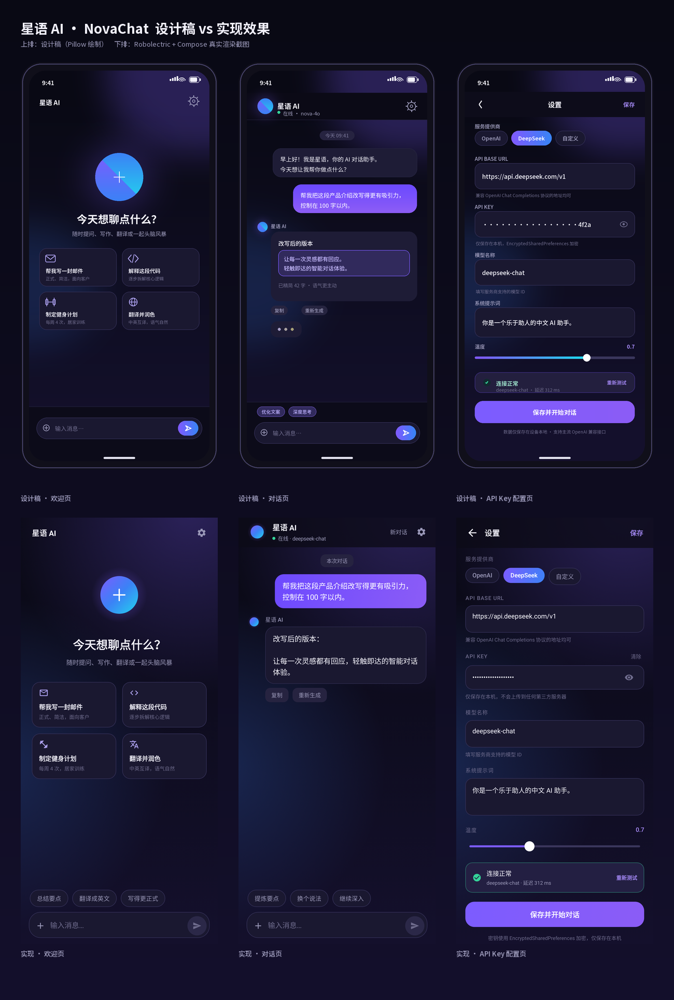

# 星语 AI · NovaChat

一个 Android 端的 AI 对话 Agent 应用（Kotlin + Jetpack Compose + Material 3），支持任意 **OpenAI 兼容** 的 Chat Completions 接口（OpenAI / DeepSeek / 自建网关）。

先出设计稿，再按设计稿还原实现，最后在本地完成构建与签名。

---

## 1. 交付物

| 文件 | 说明 |
| --- | --- |
| `dist/NovaChat-1.0.0-release.apk` | **可直接安装的已签名 Release 包**（11 MB，minSdk 24 / targetSdk 34） |
| `dist/NovaChat-1.0.0-debug.apk` | Debug 包（applicationId 带 `.debug` 后缀，可与正式包共存） |
| `dist/SHA256SUMS.txt` | 安装包校验值 |
| `dist/screens/comparison.png` | 设计稿 vs 真机渲染效果对照图 |
| `dist/screens/welcome.png`、`chat.png`、`settings.png` | 应用真实渲染截图（Robolectric + Compose 离屏抓图，1170×2532） |
| `dist/screens/app_boot.png` | App 真实启动（MainActivity）后的首屏截图 |
| `design/design_mockup.png` | 三屏设计总览（欢迎页 / 对话页 / API 配置页） |
| `design/screen_welcome.png`、`screen_chat.png`、`screen_settings.png` | 单屏高保真设计稿（780×1688） |
| `design/design_spec.png` | 设计规范：色板、字号、组件、间距、交互行为 |
| `design/generate_mockups.py` | 设计稿生成脚本（Pillow 绘制，可重复产出） |
| `app/` | Android 工程源码 |
| `keystore/novachat-release.jks` | 签名密钥（演示用，密码见第 5 节） |

## 2. 设计稿


设计语言：深空紫渐变背景 + 双径向光晕、Material 3 大圆角、玻璃质感卡片、紫→蓝渐变主色 `#7C5CFF → #3B82F6`，正文 `#F2F1FA`，辅助文字 `#9A98B8`。

## 3. 已实现功能

- **欢迎页**：品牌光球、4 个快捷场景卡片、未配置密钥时的引导条、底部输入框。
- **对话页**：
  - 用户渐变气泡 / AI 深色气泡，自动滚动到底部；
  - **流式输出（SSE）** 逐字渲染 + 呼吸光标；等待首字时显示三点动效；
  - 停止生成、重新生成、一键复制；
  - 失败时在气泡内联展示错误信息（含服务商返回原文与 HTTP 状态码兜底），可重试；
  - 一键“新对话”清空本地记录。
- **API Key 配置页**：
  - 预设 `OpenAI / DeepSeek / 自定义`，选中预设自动填充 Base URL 与模型；
  - Base URL 自动补全 `/chat/completions`，`https://host/v1` 与完整地址均可；
  - API Key 密文显示 + 眼睛切换 + 一键清除；
  - 模型名称、系统提示词、温度（0–2）；
  - **测试连接**：真实发起 1 token 请求，显示成功/失败原因与耗时；
  - 密钥使用 `EncryptedSharedPreferences`（AES256-GCM）加密，仅存本机。
- **本地持久化**：配置加密存储；对话记录以 JSON 保存在应用私有目录，冷启动可恢复。

## 4. 构建

环境：JDK 17、Android SDK Platform 34、Build-Tools 34.0.0。

```bash
cd app
echo "sdk.dir=/path/to/android-sdk" > local.properties
export JAVA_HOME=/path/to/jdk17
./gradlew assembleRelease        # 输出 app/build/outputs/apk/release/app-release.apk
./gradlew testDebugUnitTest      # 单元测试（7 项）
```

签名信息通过环境变量覆盖（缺省值指向 `../keystore/novachat-release.jks`）：

```bash
NOVA_KEYSTORE=/abs/path/novachat-release.jks \
NOVA_STORE_PASSWORD=novachat2026 \
NOVA_KEY_ALIAS=novachat NOVA_KEY_PASSWORD=novachat2026 \
./gradlew assembleRelease
```

## 5. 签名

- keystore：`keystore/novachat-release.jks`
- alias：`novachat`，store/key 密码：`novachat2026`
- 证书：`CN=NovaChat, OU=Mobile, O=NovaChat, L=Shanghai, ST=Shanghai, C=CN`，RSA 4096
- APK 采用 **v2（APK Signature Scheme v2）** 签名，`apksigner verify` 通过

> 该密钥仅用于本次演示交付，正式上架请自行生成并妥善保管。

## 6. 使用方法

1. 安装 `dist/NovaChat-1.0.0-release.apk`（Android 7.0+）。
2. 首次进入点击“去配置”，选择服务商（如 DeepSeek）→ 填入自己的 API Key → “测试连接” → “保存并开始对话”。
3. 在输入框提问即可；回答过程中可点击停止，回答结束后可复制或重新生成。

## 7. 代码结构

```
app/app/src/main/java/com/novachat/app/
├── MainActivity.kt            # 入口 + 页面路由 + 剪贴板/Toast
├── ChatViewModel.kt           # UiState 单一状态源、发送/流式/重试/配置动作
├── data/
│   ├── Settings.kt            # 配置模型 + 服务商预设 + URL 归一化
│   ├── SettingsRepository.kt  # EncryptedSharedPreferences 存储（含降级）
│   ├── ChatMessage.kt
│   └── ChatStore.kt           # 会话 JSON 持久化
├── net/
│   └── ChatApi.kt             # OkHttp + SSE 流式解析 + 连接测试 + 错误映射
└── ui/
    ├── WelcomeScreen.kt / ChatScreen.kt / SettingsScreen.kt
    ├── components/            # 光球、气泡、输入框、通用控件
    └── theme/                 # 色板 / 排版 / 形状 / 渐变背景
```

## 8. 验证记录

所有验证均在本仓库内实际执行，产物可在 `dist/` 与 `app/app/build/` 下复查。

**单元 / 集成测试：16 项全部通过**（`./gradlew testDebugUnitTest`）

| 测试类 | 数量 | 覆盖内容 |
| --- | --- | --- |
| `ChatLogicTest` | 7 | Base URL 归一化、配置完整性判断、Key 掩码、请求体构造（含 system 消息/过滤空消息与报错消息）、错误信息映射、SSE 增量解析 |
| `ApiIntegrationTest` | 5 | 用 MockWebServer 跑真实 OkHttp 请求：SSE 流式增量与 `[DONE]` 结束、Authorization/路径/请求体校验、401 错误透传、未配置密钥不发请求、连接测试与 404 映射 |
| `ScreenshotTest` | 3 | Robolectric + Compose 真实渲染三屏并抓图，用于与设计稿比对 |
| `AppBootTest` | 1 | 真实启动 `MainActivity`（ViewModel + 加密存储降级 + 完整 Compose 树），并对启动界面抓图 `dist/screens/app_boot.png` |

**构建与签名**

- `assembleRelease`：BUILD SUCCESSFUL，输出 11.3 MB APK
- `apksigner verify`：`Verifies`，v2 签名有效；证书 `CN=NovaChat`，SHA-256 `ed3422dd…28f88`，RSA 4096
- `aapt2 dump badging`：`package=com.novachat.app`、`versionName=1.0.0`、`sdkVersion=24`、`targetSdkVersion=34`、应用名 `星语 AI`

**界面比对**



上排为设计稿，下排为应用真实渲染截图，布局、配色、组件圆角与字号基本一致。

## 9. 当前限制

- 单会话模型：仅保留最近一段对话记录，“新对话”会清空本地历史。
- 回复以纯文本渲染，暂未支持 Markdown / 代码块高亮。
- 输入框“+”为占位入口（图片/语音等附件能力未实现）。
- 未接入账号体系与云同步，所有数据仅在本机。
